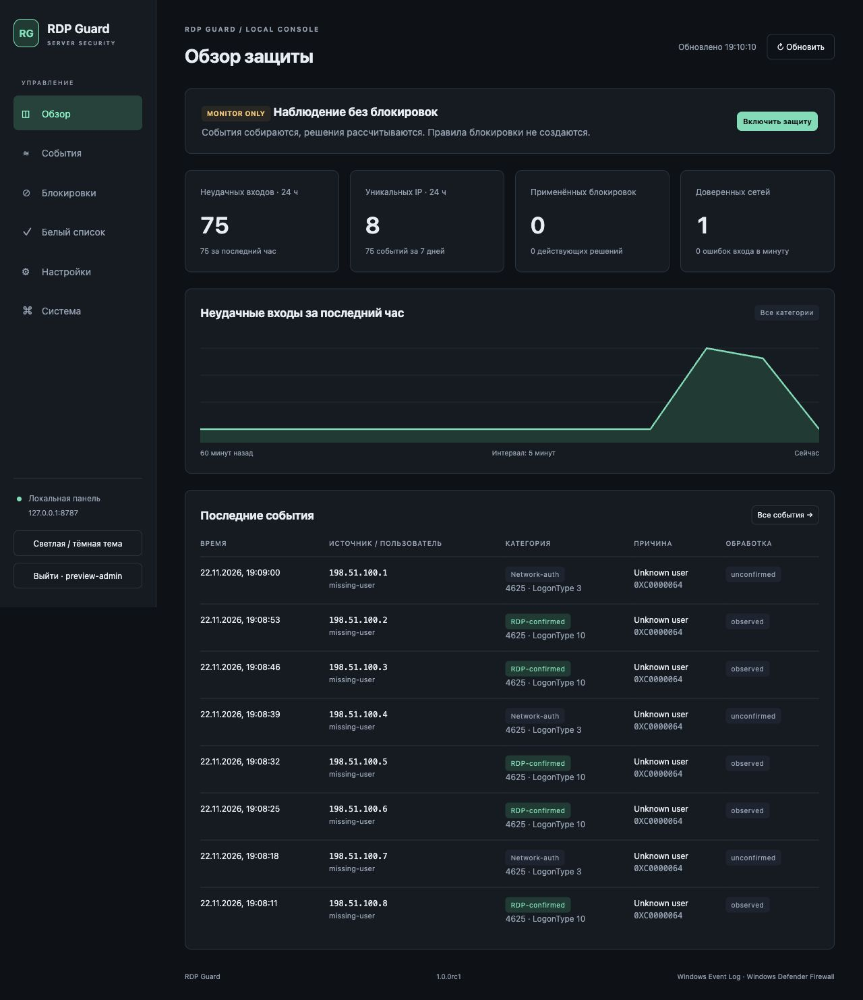

# RDP Guard

**Эта ветка: `1.1.0.dev0`, разработка интеграции с nginx stream/NPM.**
Windows-компонент и отдельный Linux-агент остаются частями RDP Guard. Добавлены
автоматический обмен исходными событиями по mTLS, сопоставление реальных клиентов,
защита общего адреса прокси от локального бана и раздел «Прокси» в панели.
По умолчанию агент только наблюдает; исполнение правил закрыто до нативной приёмки.
Это не опубликованный релиз. [Установка, ограничения и план проверки агента](docs/PROXY_AGENT.md).

Локальная защита RDP для Windows Server 2022: Windows Event Log → SQLite → проверяемые правила Windows Defender Firewall. Python 3.12+, две Windows-службы, веб-панель на **http://127.0.0.1:8787**.

**Текущий выпуск: 1.0.0-rc.8, предварительный.** Начальный режим — **MONITOR ONLY**. Приёмка на целевой системе с RDS, Kaspersky Endpoint Security 14.2, SQL Server и 1С обязательна перед production ACTIVE. Репозиторий и CI не подключаются к рабочему серверу.



На снимке — искусственные события локальной проверки интерфейса, не данные рабочего сервера.

## Готовая сборка

[Скачать Windows x64 из Releases](https://github.com/tolabzik/RDP_GUARD/releases). Архив содержит `rdpguard.exe`, `guardservice.exe`, `webservice.exe`, общую папку `_internal`, скрипты установки/обновления/удаления и документацию. Python, Node.js, Docker и интернет на сервере не нужны. Рядом публикуется SHA-256. Бинарники пока без Authenticode-подписи.

GitHub Actions проверяет код на Linux и Windows Server 2022, выполняет изолированные проверки настоящих Event Log / Firewall API, собирает PyInstaller-дистрибутив и устанавливает обе службы на одноразовом Windows runner. При успешной проверке тега `v*` публикуется GitHub prerelease. Обычные коммиты `main` также создают скачиваемый build artifact.

В rc.8 добавлена подписка на `Microsoft-Windows-RemoteDesktopServices-RdpCoreTS/Operational`, событие **140** — отказ RDP из-за неверного имени пользователя или пароля. Адрес берётся из родного поля `IPString`. Это позволяет учитывать отказы на Server 2012 R2, где Security 4625 может записывать `IpAddress=-`. События 140 с IP учитываются автоматически, без включения общего Network-auth. Статус новой подписки виден на обзоре и в «Системе».

Для обновления существующей установки распакуйте архив полностью и выполните из его папки в PowerShell от администратора:

```powershell
powershell.exe -NoProfile -ExecutionPolicy Bypass -File ".\Update.ps1"
```

Учётная запись, настройки, списки и история сохраняются. После обновления остаётся Monitor Only; для блокировок нужны активация, новое RDP-переподключение и подтверждение в панели.

В rc.2 исправлено зависание канала управления: в rc.1 службы могли показывать Running, а панель — «Нет связи со службой», CLI — `121 / WaitNamedPipe`. Для существующей установки распакуйте новый ZIP и запустите `Update.ps1` от администратора. Учётная запись панели, настройки и история сохраняются. После обновления проверьте `rdpguard.exe status` и обновите страницу панели.

В rc.3 исправлен ложный отказ проверки watchdog на русской Windows: учётная запись задачи проверяется по SID, поэтому имя `СИСТЕМА` распознаётся корректно. Окно проверки перед ACTIVE и команда `rdpguard.exe preflight` показывают IP административных RDP-сессий и наличие этих адресов в whitelist. Проверка ничего не активирует и не добавляет адреса автоматически.

В rc.4 исправлена привязка адресов за NAT: административная сессия получает IP из серверного события LSM 21/25, сопоставленного с пользователем, номером сессии и временем текущего подключения Windows. Этот адрес используется для whitelist, защиты администратора и подтверждения переподключения. Частный адрес, сообщённый RDP-клиентом, остаётся справочным. При отсутствии доказательства ACTIVE не включается.

В rc.5 исправлено подтверждение обычного RDP-переподключения: оно больше не требует появления 4624/10 или 4778. Проверяются серверное событие LSM 21/25 и время нового подключения текущей административной WTS-сессии после активации. Поэтому последовательность 4624/7 + LSM 25 проходит проверку; отдельное событие разблокировки типа 7 доказательством RDP не считается.

В rc.6 исправлена регистрация задачи отката на Server 2012 R2: используется штатный XML Task Scheduler с бессрочным интервалом в минуту и запуском при загрузке. `Update.ps1` также восстанавливает отсутствующую задачу. Инструкция для прерванной установки — в [руководстве эксплуатации](docs/OPERATIONS.md#восстановление-после-ошибки-repetitioninterval-на-server-2012-r2).

## PowerShell 5.1 для Windows Server 2012 R2

Скрипты установки и обновления требуют **Windows PowerShell 5.1**. Для **Windows Server 2012 R2 x64** используйте Windows Management Framework (WMF) 5.1:

- **[Скачать WMF 5.1 с Microsoft — 19 МБ](https://download.microsoft.com/download/6/F/5/6F5FF66C-6775-42B0-86C4-47D41F2DA187/Win8.1AndW2K12R2-KB3191564-x64.msu)**.
- Файл: `Win8.1AndW2K12R2-KB3191564-x64.msu`. Также доступен на [официальной странице загрузки](https://www.microsoft.com/en-us/download/details.aspx?id=54616).
- Требуется **.NET Framework 4.5.2 или новее**. После установки может потребоваться перезагрузка сервера; запланируйте её с учётом работающих сеансов и приложений. [Требования Microsoft](https://support.microsoft.com/en-us/topic/update-for-windows-management-framework-5-1-for-windows-8-1-and-windows-server-2012-r2-4120fd27-3163-bc51-c851-10f6e2d4bd64).

Запустите пакет от администратора. После установки и необходимой перезагрузки откройте новое окно PowerShell и проверьте версию:

```powershell
$PSVersionTable.PSVersion
```

Ожидается `Major = 5`, `Minor = 1`. Затем можно переходить к `Install.ps1`.

Полная совместимость служб и режима ACTIVE с Windows Server 2012 R2 пока не подтверждена. Проверяемая в CI платформа — Windows Server 2022; успешный запуск `rdpguard.exe --version` на 2012 R2 сам по себе не подтверждает работу защиты.

В rc.7 исправлен преждевременный переход в Monitor Only при переподключении: если WTS уже показывает новое соединение, а LSM ещё отдаёт старую запись, проверка повторно читает весь список сессий с общим бюджетом ожидания 2 секунды. Старое событие не принимается; постоянная ошибка по-прежнему отключает блокировки, срок подтверждения не продлевается.

## Первый запуск

1. Проверьте SHA-256 скачанного архива, распакуйте его полностью.
2. Откройте PowerShell **от имени администратора** и выполните `./Install.ps1`. Укажите нового администратора панели и пароль длиной от 12 символов. Стандартных паролей нет.
3. Откройте **http://127.0.0.1:8787** в браузере на сервере. Добавьте постоянный административный IP/CIDR в whitelist.
4. Проверьте поступление событий в Monitor Only, аудит Windows и диагностику. Установщик не изменяет существующие правила, порт RDP или настройки аудита.
5. Перед ACTIVE пройдите [контролируемую приёмку](docs/ACCEPTANCE.md). Нужны проверенный резервный доступ, работающий независимый откат, корректные разрешающие правила и whitelist текущей административной RDP-сессии.
6. После включения повторно подключитесь по RDP и подтвердите подключение в панели в течение 180 секунд. Закройте окно RDP, не завершая сеанс Windows, и подключитесь снова. Подтверждение проверяется по LSM 21/25, связанному с текущей административной WTS-сессией, адресом из whitelist и временем подключения после активации. Без подтверждения собственные блокировки снимаются.

Если политика PowerShell блокирует локальные скрипты, используйте утверждённый в вашей организации способ запуска; глобально отключать ExecutionPolicy не требуется.

## Аварийное отключение

В повышенной консоли, даже при остановленной Guard Service и недоступной панели:

```powershell
& 'C:\Program Files\RDPGuard\rdpguard.exe' emergency-disable
```

Команда записывает постоянный запрет блокировок и удаляет только правила с собственными идентификаторами RDP Guard. База, история, Kaspersky и посторонние правила сохраняются. `Emergency-Disable.ps1` вызывает ту же независимую команду. Повторное включение возможно только через полную проверку ACTIVE.

## Что считается RDP

`4625 + LogonType=10` → **RDP-confirmed**. `4625 + LogonType=3`, в том числе `NtLmSsp`, → **Network-auth / unconfirmed**, без автоматического реагирования по умолчанию. Тип 3 не доказывает обращение к RDP: это может быть SMB или другая служба. Даже после явного включения этой категории блокируются только TCP/UDP текущего RDP-порта. Событие 1149 хранится как контекст, но не подтверждает интерактивный вход.

`RdpCoreTS 140` → **RDP-confirmed**: самостоятельный отказ RDP с адресом из `IPString`. Имя пользователя в этом событии отсутствует и не подставляется из соседнего 4625. События установки TCP-соединения, например 131, отказом не считаются. Непригодный/отсутствующий IP даёт обработку `no-source-ip` («Нет IP для блокировки»).

Порог считается **для одного IP отдельно по каждому журналу**, а не по сумме 4625 и 140: одна попытка может попасть в оба. По умолчанию нужны 10 подходящих отказов из одного источника за 300 секунд; первое решение действует час. Десять отказов от десяти разных IP либо десять за час не достигают этого порога. В обзоре показывается количество записей об отказах, включая записи без IP, а не число уникальных попыток; число уникальных IP исключает записи без адреса. `health.failure_sources` показывает записи и записи с IP по каждому источнику за сутки.

Подтверждающая документация: [Microsoft: событие 4625 и типы входа](https://learn.microsoft.com/windows/security/threat-protection/auditing/event-4625), [закладки событий](https://learn.microsoft.com/en-us/windows/win32/wes/bookmarking-events), [Windows Firewall INetFwRule](https://learn.microsoft.com/en-us/windows/win32/api/netfw/nn-netfw-inetfwrule).

## Основные ограничения безопасности

- Только собственные входящие блокирующие правила группы `RDPGuard.Managed`; отдельные TCP и UDP, порт 33345 по умолчанию, конкретные IP/CIDR. Пустой список удаляет собственные правила и не создаёт wildcard.
- Whitelist и подтверждённые активные административные сессии защищены. Автоматическое расширение адреса до подсети запрещено. Ручные подсети ограничены /24 IPv4 или /64 IPv6 и более узкими.
- Веб-служба работает как LocalService с отдельным service SID. Доступ к SQLite и firewall есть только у SYSTEM/администраторов. Именованный канал имеет явный ACL, запрещает удалённых клиентов, проверяет Windows-идентичность и сессию панели.
- Argon2id, HttpOnly/SameSite Strict cookie, CSRF, проверка Origin/Host и loopback, ограничение входов. Все ресурсы интерфейса локальные.
- При ошибке firewall нет ложного статуса «применено»: система переходит в наблюдение и повторяет снятие собственных правил. Независимая задача `RDPGuardRollback` снимает блокировки после истечения активации или пропажи heartbeat службы.

## CLI

Все команды требуют повышенную консоль Windows. Кроме bootstrap, watchdog и emergency, команды общаются напрямую с Guard Service, без веб-сервера.

```powershell
rdpguard.exe status
rdpguard.exe health
rdpguard.exe preflight
rdpguard.exe list-blocks
rdpguard.exe list-whitelist
rdpguard.exe whitelist-add 203.0.113.10 --comment 'Administrator'
rdpguard.exe whitelist-remove 203.0.113.10
rdpguard.exe block 198.51.100.7 --seconds 3600 --comment 'Manual investigation'
rdpguard.exe unblock 198.51.100.7
rdpguard.exe monitor-only
rdpguard.exe firewall-reconcile
rdpguard.exe export-config
rdpguard.exe init-admin --username operator
rdpguard.exe reset-admin --username operator
rdpguard.exe emergency-disable
```

Указанные адреса — примеры из документационных диапазонов; замените их реальными. `block` без `--seconds` создаёт постоянную запись. В Monitor Only она не применяется к firewall.

## Разработка и сборка

```powershell
py -3.12 -m venv .venv
.\.venv\Scripts\Activate.ps1
python -m pip install -e '.[test,build]'
python -m pytest -q
python -m ruff check src tests scripts
.\scripts\Build.ps1
```

PyInstaller собирается только на Windows x64. Для тестов ядра подходят Linux/macOS с Python 3.12+. Нативные тесты выключены по умолчанию; **только на одноразовой Windows VM** установите `RDP_GUARD_NATIVE_TESTS=1`. Они временно создают узкие правила на документационные IP и удаляют их в `finally`.

Подробности: [архитектура и угрозы](docs/ARCHITECTURE.md), [эксплуатация](docs/OPERATIONS.md), [приёмка](docs/ACCEPTANCE.md), [тестирование](docs/TEST_REPORT.md), [известные ограничения](docs/LIMITATIONS.md).

Исследовательский прототип для общего nginx stream описан в [наблюдении за прокси](docs/PROXY_OBSERVATION.md).
Он сопоставляет диагностические выгрузки Windows и Linux, не входит в выпущенный
установщик и не применяет блокировки.
